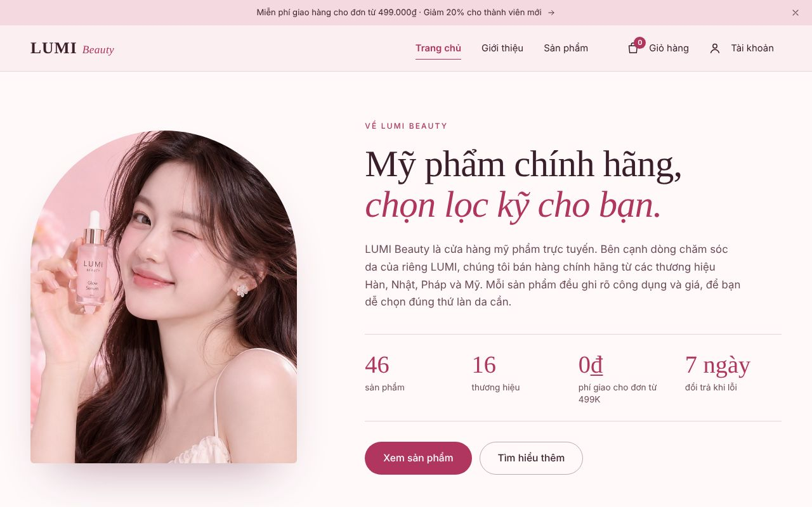
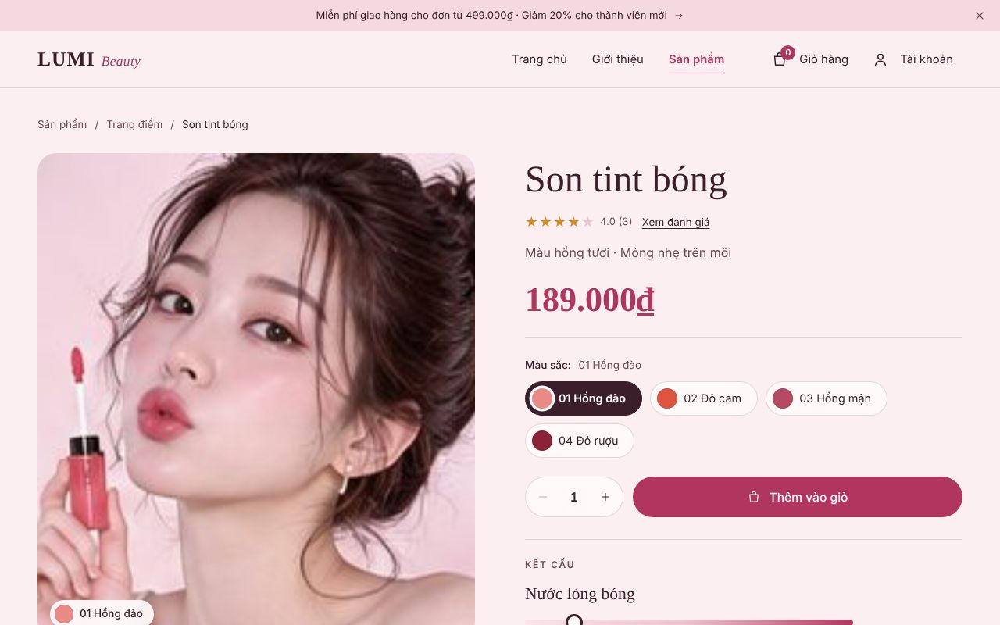
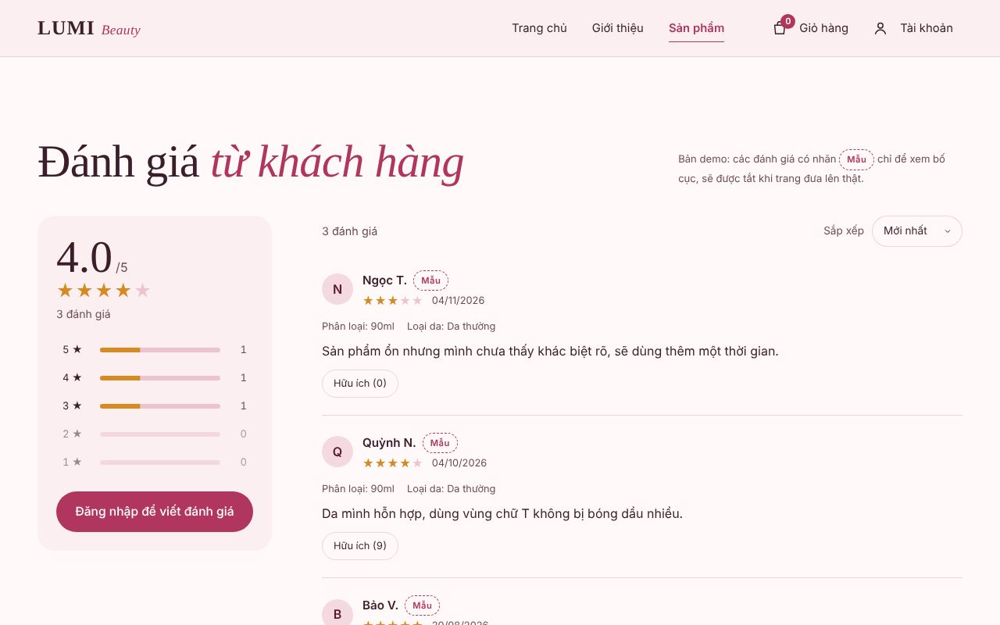
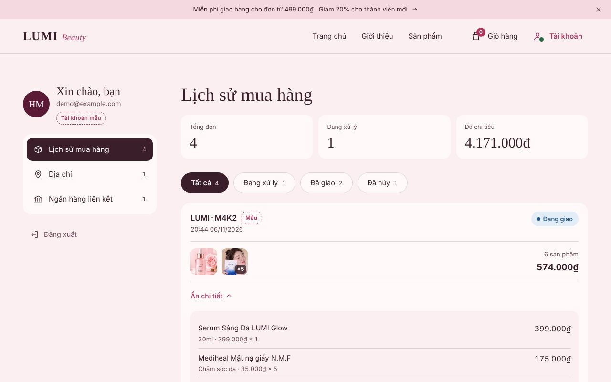

# LUMI Beauty — Website bán mỹ phẩm (React + Vite)

Giao diện cửa hàng mỹ phẩm trực tuyến **LUMI Beauty**, phong cách biên tập (editorial) tông hồng pastel, viết hoàn toàn bằng tiếng Việt. Trang gồm Flash Sale, danh mục 46 sản phẩm có trang chi tiết và đánh giá sao, giỏ hàng, tài khoản khách hàng (lịch sử mua hàng, địa chỉ, ngân hàng liên kết).
 https://hanny2005.github.io/-DEMO_lumi-beauty_Fontend-React-/
> **Trạng thái: bản demo giao diện (frontend).** Chưa có máy chủ. Giỏ hàng, tài khoản, đơn hàng và đánh giá đang lưu trong `localStorage` của trình duyệt. Xem mục [Trước khi đưa lên thật](#trước-khi-đưa-lên-thật).



| Chi tiết sản phẩm | Đánh giá sao |
| --- | --- |
|  |  |
| **Tài khoản khách hàng** | **Flash Sale** |
|  |  |

---

## Mục lục

- [Tính năng](#tính-năng)
- [Bắt đầu nhanh](#bắt-đầu-nhanh)
- [Công nghệ](#công-nghệ)
- [Cấu trúc thư mục](#cấu-trúc-thư-mục)
- [Điều hướng (routes)](#điều-hướng-routes)
- [Chỉnh nội dung](#chỉnh-nội-dung)
- [Làm việc với Claude Code (Skills)](#làm-việc-với-claude-code-skills)
- [Trước khi đưa lên thật](#trước-khi-đưa-lên-thật)
- [Quy ước khi đóng góp](#quy-ước-khi-đóng-góp)
- [Ghi chú về hình ảnh và thương hiệu](#ghi-chú-về-hình-ảnh-và-thương-hiệu)

---

## Tính năng

**Trang chủ** (`#trang-chu`)
- Giới thiệu sơ lược về cửa hàng kèm số liệu nhanh.
- **Flash Sale**: đồng hồ đếm ngược, % giảm, giá sale, số suất giới hạn, nút tự khóa khi hết giờ.
- Hỏi đáp (accordion) và Liên hệ (thông tin + form có kiểm tra dữ liệu).

**Sản phẩm** (`#san-pham`)
- Hero và khu vực mua sản phẩm chủ lực **LUMI Glow Serum**.
- Danh mục 45 sản phẩm: lọc theo nhóm (Chăm sóc da, Trang điểm, Cơ thể, Nước hoa) và theo thương hiệu, nút "Xem thêm".

**Chi tiết sản phẩm** (`#sp-<mã>`, ví dụ `#sp-br-04`)
- Chọn phân loại: màu (chấm màu), tông nền, dung tích (giá đổi theo), quy cách.
- Thanh kết cấu **Lỏng ↔ Đặc**, bảng **loại da phù hợp**, thông số, cách dùng.
- **Đánh giá sao**: điểm trung bình, biểu đồ 5→1 sao (bấm để lọc), sắp xếp, nút "Hữu ích". Khách đăng nhập tự viết đánh giá; nếu có đơn **đã giao** chứa sản phẩm thì đánh giá có nhãn **"Đã mua hàng"**.
- Sản phẩm liên quan.

**Giỏ hàng** (ngăn kéo bên phải)
- Đổi số lượng, xóa, thanh tiến độ miễn phí giao hàng.
- Đặt hàng: chọn địa chỉ giao, cách thanh toán (COD, chuyển khoản, ngân hàng đã liên kết). Đơn mới vào lịch sử mua hàng.

**Tài khoản khách hàng** (`#tai-khoan`)
- Đăng nhập, tạo tài khoản, hoặc **"Dùng tài khoản mẫu"** để xem nhanh dữ liệu có sẵn.
- `#don-hang`: lịch sử mua hàng, lọc theo trạng thái, xem chi tiết, hủy đơn đang chờ, mua lại.
- `#dia-chi`: thêm/sửa/xóa địa chỉ, chọn mặc định (danh sách 34 tỉnh thành sau sắp xếp 2025).
- `#ngan-hang`: liên kết ngân hàng — **chỉ lưu tên ngân hàng, chủ tài khoản và 4 số cuối**.

**Trang Giới thiệu** (`#gioi-thieu`): câu chuyện thương hiệu, bộ ảnh kéo/vuốt có lightbox, thành phần, đăng ký nhận tin.

**Chung**
- Responsive từ 360px đến màn hình lớn, menu di động, thanh mua dính đáy trên điện thoại.
- Tiếp cận (a11y): điều hướng bằng bàn phím, focus trap trong hộp thoại, đóng bằng Esc, `aria-*` đầy đủ, vùng chạm ≥ 44px, tôn trọng `prefers-reduced-motion`.
- SEO cơ bản: meta, Open Graph, JSON-LD Product.

## Bắt đầu nhanh

Yêu cầu: **Node.js 20+**.

```bash
npm install
npm run dev       # http://localhost:5173
npm run build     # build ra thư mục dist/
npm run preview   # xem thử bản build
```

Mở `http://localhost:5173/#sp-br-04` để vào thẳng một trang chi tiết, hoặc `#tai-khoan` → **Dùng tài khoản mẫu** để xem phần tài khoản.

## Công nghệ

| Hạng mục | Lựa chọn |
| --- | --- |
| Giao diện | React 19 (function components, hooks) |
| Build | Vite 7 + `@vitejs/plugin-react` |
| State | React Context: `CartProvider`, `AccountProvider`, `ReviewsProvider` |
| Lưu trữ demo | `localStorage` (mọi lần đọc/ghi bọc `try/catch`) |
| Điều hướng | Hash routing tự viết trong `App.jsx` (không dùng thư viện router) |
| Style | Một file CSS thuần với design tokens ở `:root`, không dùng framework CSS |
| Font | Playfair Display (tiêu đề) + Be Vietnam Pro (nội dung), hỗ trợ đầy đủ dấu tiếng Việt |
| Icon | SVG nội tuyến tự vẽ (`components/Icons.jsx`) |

Không có thư viện runtime nào ngoài React.

## Cấu trúc thư mục

```
.
├── CLAUDE.md                 # Hướng dẫn cho Claude Code (kiến trúc, quy ước)
├── .claude/skills/           # Skill cho Claude Code — xem mục bên dưới
├── docs/screenshots/         # Ảnh chụp dùng trong README
├── index.html                # Meta, font, JSON-LD
├── vite.config.js
└── src/
    ├── main.jsx              # Điểm vào
    ├── App.jsx               # Hash routing + các trang
    ├── data.js               # NỘI DUNG: thương hiệu, sản phẩm, giá, FAQ, Flash Sale, tỉnh thành, ngân hàng
    ├── details.js            # Chi tiết theo loại sản phẩm: kết cấu, loại da, phân loại, cách dùng; đánh giá mẫu
    ├── cart.jsx              # Giỏ hàng + hook useReveal, useFocusTrap
    ├── account.jsx           # Tài khoản (demo): đăng nhập, đơn hàng, địa chỉ, ngân hàng
    ├── reviews.jsx           # Đánh giá sao + component <Stars>, <RatingLine>
    ├── styles.css            # Toàn bộ giao diện, token màu/chữ ở :root
    ├── assets/               # Ảnh (assets/catalog, assets/brands)
    └── components/
        ├── Header.jsx        # Thanh thông báo, header dính, menu di động
        ├── Home.jsx          # Trang chủ: giới thiệu, Flash Sale, liên hệ
        ├── Hero.jsx          # Hero LUMI Glow + dải chữ chạy
        ├── Purchase.jsx      # Khu vực mua LUMI Glow + ngăn kéo giỏ hàng/đặt hàng
        ├── Catalog.jsx       # Danh mục, bộ lọc
        ├── ProductDetail.jsx # Trang chi tiết + đánh giá + liên quan
        ├── Account.jsx       # Hộp đăng nhập + trang tài khoản
        ├── Gallery.jsx       # Bộ ảnh kéo/vuốt + lightbox
        ├── Sections.jsx      # Thành phần, câu chuyện, FAQ, đăng ký, footer
        └── Icons.jsx
```

## Điều hướng (routes)

Mọi route là hash đơn giản `#ten`, xử lý trong `src/App.jsx`.

| Hash | Trang |
| --- | --- |
| `#trang-chu` (mặc định) | Trang chủ |
| `#gioi-thieu` | Giới thiệu |
| `#san-pham` | Sản phẩm |
| `#sp-<mã>` | Chi tiết sản phẩm, ví dụ `#sp-ba-03`, `#sp-br-11`, `#sp-lumi-glow-30ml` |
| `#tai-khoan`, `#don-hang`, `#dia-chi`, `#ngan-hang` | Tài khoản và các mục |

Link tới một section (ví dụ `#mua`, `#bo-suu-tap`, `#hoi-dap`, `#lien-he`) tự mở đúng trang rồi cuộn tới — bảng `SECTION_VIEW` trong `App.jsx`.

## Chỉnh nội dung

Hầu hết nội dung **không cần sửa component**:

| Muốn sửa | File → mục |
| --- | --- |
| Tên, slogan, thông báo, liên hệ, phí giao | `src/data.js` → `BRAND` |
| Sản phẩm, giá, ảnh | `src/data.js` → `BASE_CATALOG`, `BRAND_CATALOG` |
| Flash Sale (giờ kết thúc, giá, số suất) | `src/data.js` → `FLASH_SALE` |
| Câu hỏi thường gặp | `src/data.js` → `FAQ` |
| Kết cấu, loại da, màu/dung tích, cách dùng | `src/details.js` → `KINDS`, `KIND_OF`, `OVERRIDES` |
| Bật/tắt đánh giá mẫu | `src/details.js` → `SHOW_SAMPLE_REVIEWS` |
| Màu sắc, font | `src/styles.css` → khối `:root` |

Thêm sản phẩm mới: xem skill [`add-product`](.claude/skills/add-product/SKILL.md).

## Làm việc với Claude Code (Skills)

Repo kèm sẵn hướng dẫn cho [Claude Code](https://docs.claude.com/en/docs/claude-code/overview):

- **`CLAUDE.md`** — Claude đọc tự động khi mở dự án: kiến trúc, quy ước code, quy tắc nội dung mỹ phẩm.
- **`.claude/skills/`** — các quy trình lặp lại, Claude tự dùng khi yêu cầu khớp mô tả (hoặc gọi bằng tên):

| Skill | Dùng khi |
| --- | --- |
| [`add-product`](.claude/skills/add-product/SKILL.md) | Thêm / sửa / xóa sản phẩm, thêm vào Flash Sale |
| [`edit-content`](.claude/skills/edit-content/SKILL.md) | Viết hoặc sửa câu chữ tiếng Việt, giá, mô tả công dụng |
| [`build-and-check`](.claude/skills/build-and-check/SKILL.md) | Kiểm tra trước khi commit: build, chạy thử, a11y, mobile |
| [`go-live-checklist`](.claude/skills/go-live-checklist/SKILL.md) | Chuẩn bị đưa website lên thật |

Ví dụ yêu cầu: *"Thêm sản phẩm Toner hoa cúc 150ml giá 220.000₫ vào nhóm Chăm sóc da"* — Claude sẽ theo skill `add-product`.

## Trước khi đưa lên thật

Chi tiết từng bước trong skill [`go-live-checklist`](.claude/skills/go-live-checklist/SKILL.md). Tóm tắt:

**Bắt buộc**
- [ ] Đặt `SHOW_SAMPLE_REVIEWS = false` (`src/details.js`). Không dùng đánh giá tự viết thay khách.
- [ ] Thay toàn bộ **giá mẫu** trong `BASE_CATALOG`, `BRAND_CATALOG`, `FLASH_SALE`.
- [ ] Điền `BRAND.contact`, `BRAND.notificationNumber` (số phiếu công bố mỹ phẩm).
- [ ] Đối chiếu kết cấu, loại da, tên màu, dung tích với **nhãn sản phẩm thật** (`src/details.js`).
- [ ] Rà câu chữ: quảng cáo mỹ phẩm không được ngụ ý điều trị ("trị nám", "xóa nhăn", "trẻ hóa"…).
- [ ] Thay ảnh dựng bằng ảnh chụp sản phẩm thật, đặc biệt ảnh hàng thương hiệu (`src/assets/brands`).

**Cần máy chủ (backend)**
- [ ] Đăng nhập thật có xác thực — thay các hàm trong `src/account.jsx`.
- [ ] Lưu đơn hàng, địa chỉ, đánh giá ở máy chủ; nhãn "Đã mua hàng" dựa trên đơn đã giao thật.
- [ ] Liên kết ngân hàng qua **cổng thanh toán** (VNPAY, MoMo, cổng của ngân hàng…). Không tự lưu số tài khoản.
- [ ] `BRAND.checkoutUrl`, `BRAND.contactEndpoint`, `BRAND.newsletterEndpoint`.

## Quy ước khi đóng góp

- Nhánh: `feature/<ten>`, `fix/<ten>`.
- Commit theo [Conventional Commits](https://www.conventionalcommits.org/), mô tả tiếng Việt: `feat: thêm bộ lọc theo giá`, `fix: sửa tràn ngang ở thẻ sản phẩm`.
- Chạy skill `build-and-check` (hoặc ít nhất `npm run build`) trước khi mở pull request.

## Ghi chú về hình ảnh và thương hiệu

- Ảnh trong `src/assets` được cắt từ ảnh mockup do AI tạo, chỉ dùng cho bản demo. Ảnh trong `src/assets/brands` có logo bị sai chữ, **phải thay trước khi bán thật**.
- Tên các thương hiệu (Laneige, Innisfree, SK-II, CeraVe…) thuộc về chủ sở hữu tương ứng; dự án chỉ dùng để mô tả hàng chính hãng được bán.
- Thông tin kết cấu, loại da, phân loại là dữ liệu tham khảo theo loại sản phẩm, không phải thông số chính thức của hãng.
